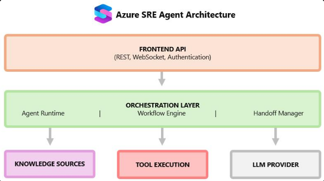

Azure Incident Management Agent
1. Project Overview

Project: Azure Incident Management Agent
Reference Repository: Microsoft SRE Agent

Objective

Build an AI-powered incident management solution using Microsoft Azure SRE Agent to automatically detect, investigate, analyze, and assist in resolving application and infrastructure incidents.

The solution will integrate Azure monitoring services with AI agents to reduce manual troubleshooting, accelerate root cause analysis, and improve incident resolution time.

Key Capabilities
Automated incident detection using Azure Monitor.
Application monitoring using Application Insights.
Centralized logging using Log Analytics Workspace.
AI-powered incident investigation.
Root cause analysis using logs, metrics, traces, and source code.
Knowledge base integration with troubleshooting documentation.
Automated remediation recommendations.
Human approval before critical remediation actions.
Incident reporting and documentation.
2. High-Level Architecture
mermaid
flowchart TB

    USER["User / Application"]

    subgraph AZURE["Microsoft Azure Environment"]

        APP["Sample Application Azure Container Apps"]

        MON["Azure Monitor"]
        AI["Application Insights"]
        LAW["Log Analytics Workspace"]

        ALERT["Alert Rules Incident Detection"]

        SRE["Azure SRE Agent"]

        subgraph AGENTS["AI Investigation Layer"]

            TRIAGE["Incident Triage Agent"]

            INVEST["Incident Investigation Agent"]

            RCA["Root Cause Analysis Agent"]

            REM["Remediation Agent"]

        end

        KB["Knowledge Base Runbooks and Documentation"]

        APPROVAL["Human Approval"]

        RECOVERY["Incident Resolution"]

    end

    GITHUB["GitHub Repository Source Code"]

    USER --> APP

    APP --> AI
    APP --> LAW

    AI --> MON
    LAW --> MON

    MON --> ALERT
    ALERT --> SRE

    SRE --> TRIAGE
    TRIAGE --> INVEST

    INVEST --> AI
    INVEST --> LAW
    INVEST --> GITHUB
    INVEST --> KB

    INVEST --> RCA
    RCA --> REM

    REM --> APPROVAL
    APPROVAL --> RECOVERY

    RECOVERY --> APP

Architecture Components
Component	Responsibility
Azure Container Apps	Hosts the sample application
Azure Monitor	Monitors Azure resources and detects incidents
Application Insights	Collects application telemetry
Log Analytics	Stores and queries logs
Azure SRE Agent	AI-powered incident investigation
AI Agents	Triage, investigation, RCA and remediation
Knowledge Base	Stores runbooks and troubleshooting guides
GitHub	Provides application source code
Human Approval	Controls critical remediation actions
3. Incident Management Workflow
mermaid
flowchart TD

    A["Application Running"] --> B["Incident Occurs"]

    B --> C["Azure Monitor Detects Issue"]

    C --> D["Alert Generated"]

    D --> E["Azure SRE Agent Triggered"]

    E --> F["Incident Triage"]

    F --> G["Collect Logs, Metrics and Traces"]

    G --> H["Analyze Application Code"]

    H --> I["Search Knowledge Base"]

    I --> J["Identify Root Cause"]

    J --> K["Generate Remediation Plan"]

    K --> L{"Approval Required?"}

    L -->|Yes| M["Human Reviews and Approves"]

    L -->|No - Authorized Policy| N["Execute Approved Automation"]

    M --> N

    N --> O["Validate Application Health"]

    O --> P{"Issue Resolved?"}

    P -->|No| G

    P -->|Yes| Q["Close Incident"]

    Q --> R["Generate Incident Report"]

4. High-Level Implementation Roadmap
Phase 1: Environment Setup
Create or use an Azure subscription.
Install Azure CLI.
Install Azure Developer CLI (azd).
Configure Azure authentication.
Clone Microsoft's SRE Agent repository.
Understand the starter lab architecture.
Phase 2: Deploy Sample Application
Deploy a sample application using Azure Container Apps.
Configure application dependencies.
Create Azure Container Registry.
Verify application accessibility.
Configure Application Insights.
Phase 3: Configure Monitoring
Create Log Analytics Workspace.
Connect Application Insights.
Configure Azure Monitor.
Create alert rules.
Configure HTTP 5xx error detection.
Phase 4: Configure Azure SRE Agent
Deploy Azure SRE Agent.
Configure managed identity.
Configure required Azure RBAC permissions.
Connect Azure monitoring data sources.
Connect GitHub repository.
Configure the agent's knowledge base.
Phase 5: Build Incident Investigation Workflow

Configure specialized agents:

Incident Handler
Receives and investigates incidents.
Collects relevant telemetry.
Identifies potential problems.
Code Analyzer
Analyzes application source code.
Identifies potentially problematic code changes.
Provides code-level investigation findings.
Issue Triager
Categorizes incidents.
Identifies severity and impact.
Helps organize follow-up actions.
Phase 6: Configure Response Plans
Configure incident response plans.
Define incident routing rules.
Connect alerts to the appropriate agents.
Configure investigation instructions.
Add human approval gates for critical actions.
Phase 7: Simulate and Test Incidents

Create controlled application failures:

HTTP 500 Internal Server Error.
Application performance degradation.
Increased response time.
Application availability issues.

Verify whether the agent can:

Detect the incident.
Collect relevant logs.
Investigate the issue.
Identify the root cause.
Recommend a solution.
Validate recovery.
Phase 8: Incident Reporting and Documentation
Capture investigation results.
Document root cause.
Record remediation actions.
Generate incident reports.
Document lessons learned.
5. Technology Stack
Category	Technology
Cloud Platform	Microsoft Azure
AI Incident Agent	Azure SRE Agent
Monitoring	Azure Monitor
Application Monitoring	Application Insights
Logging	Log Analytics Workspace
Compute	Azure Container Apps
Container Registry	Azure Container Registry
Source Control	GitHub
Query Language	KQL
Infrastructure	Azure Developer CLI / Bicep
Identity	Azure Managed Identity
Agent Configuration	Skills, Subagents and Response Plans
6. Expected Final Outcome

At the end of this project, the solution should demonstrate an AI-powered incident management workflow.

Expected results:

Detect application incidents automatically.
Investigate incidents using telemetry and source code.
Perform AI-powered root cause analysis.
Recommend appropriate remediation actions.
Execute authorized remediation workflows.
Validate application recovery.
Produce incident investigation reports.

The overall goal is to reduce manual troubleshooting effort and improve Mean Time to Resolution (MTTR).

7. Official Learning Resources
Microsoft SRE Agent GitHub Repository
Microsoft SRE Agent Starter Lab
Create and Set Up Azure SRE Agent
Automate Incident Response
Connect Source Code to Azure SRE Agent
8. Project Status

Status: Planned / Not Started

Implementation will be completed in phases, starting with Azure environment setup and sample application deployment.

02-Azure-Incident-Management-Agent/
│
├── README.md
│
├── architecture/
│   └── architecture.md
│
├── infrastructure/
│   ├── main.bicep
│   └── parameters.json
│
├── application/
│   └── sample-app/
│
├── monitoring/
│   ├── alert-rules/
│   └── kql-queries/
│
├── agent-config/
│   ├── incident-handler/
│   ├── code-analyzer/
│   └── issue-triager/
│
├── runbooks/
│   ├── application-failure.md
│   └── high-cpu-usage.md
│
├── incidents/
│   └── test-scenarios.md
│
└── docs/
    └── lessons-learned.md

## learning sequence
Deploy the sample environment.
Understand how Azure Monitor triggers an investigation.
Study how the agent queries logs using KQL.
Understand how specialized agents investigate incidents.
Test a simulated application failure.
Explore remediation and human approval.